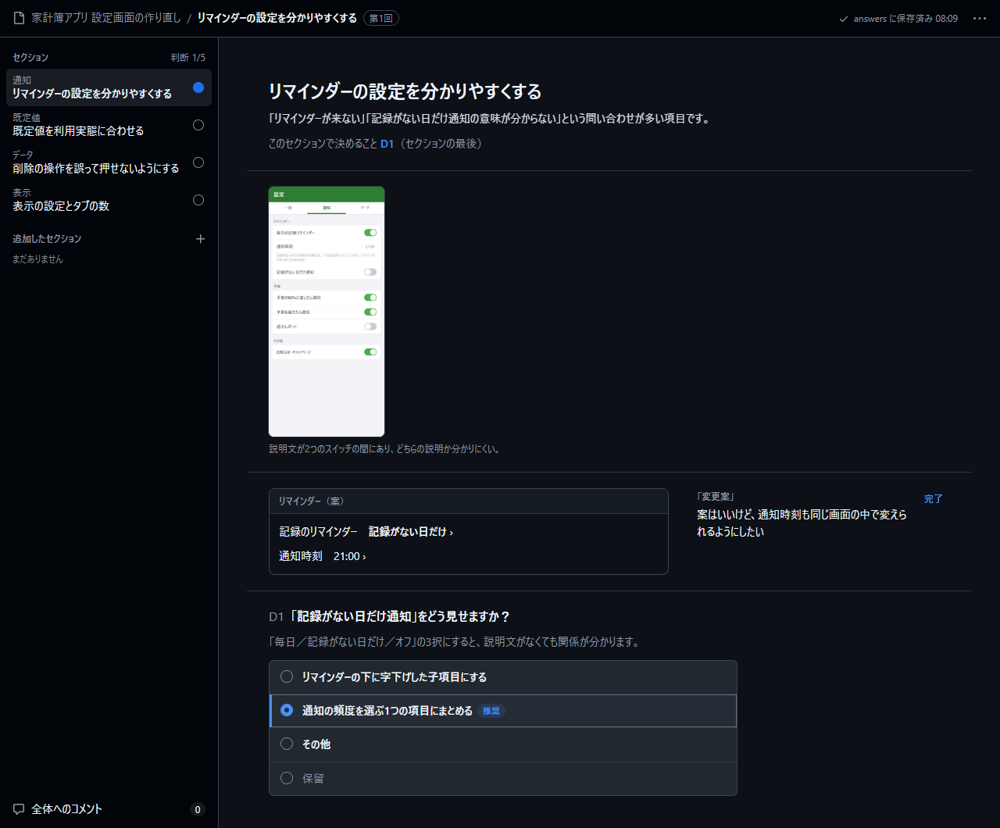
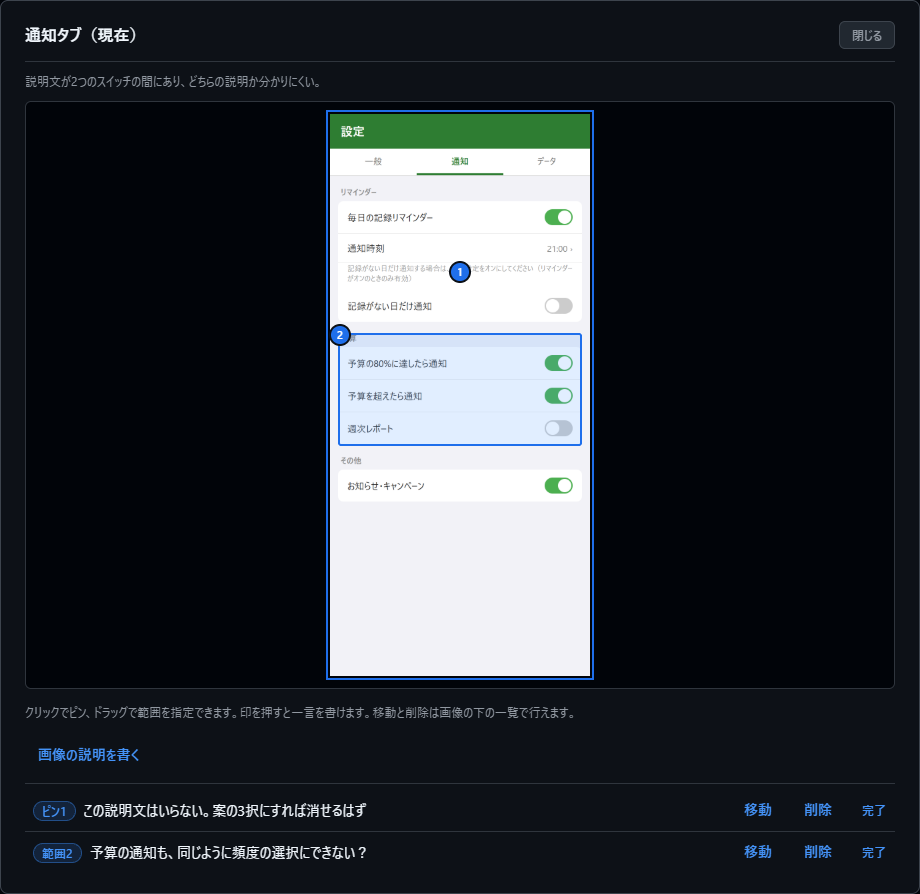
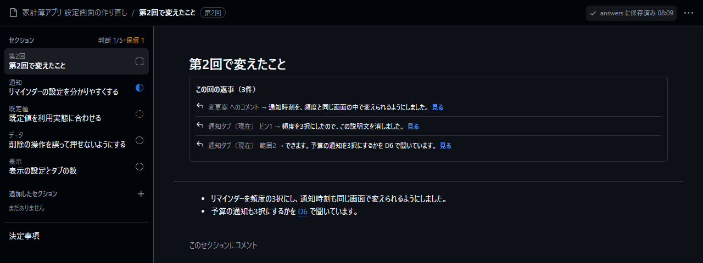
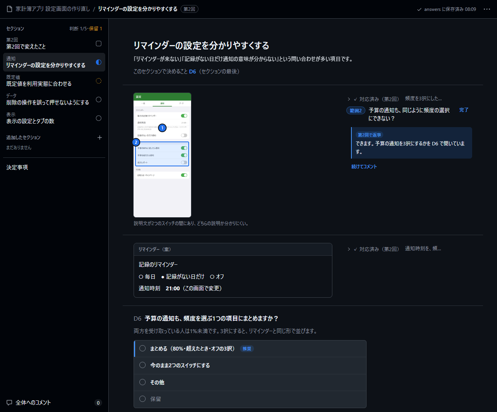

# visual-consensus

エージェントに確認したいことが多いとき、チャットに質問を並べる代わりに、答えを書き込める HTML の資料を作らせるスキルです。利用者はその資料をブラウザで開いて答えます。選択肢から選ぶほか、気になる行や画面案にコメントを書いたり、画像の気になる場所にピンを打ったりできます。回答は資料の横のフォルダに `answers.md` として保存されます。エージェントはそれを読み、回答を反映した次の回の資料を作ります。

このページの画面は家計簿アプリの設定画面を見直す見本の資料です。

## 向いている場面

- 決めてもらう判断が3つ以上あるとき。理由や比較を見せてから選んでほしいときも使えます。
- 画面案、スクリーンショット、図に対して、場所を指した指摘をもらいたいとき。
- 一度で決まらず、回答を受けて資料を直す往復が見込まれるとき。

1〜2問の質問は、エージェントがチャットで聞きます。読ませるだけの説明資料には使いません。

## 使い方

### 流れ

1. エージェントに、確認したいことを visual-consensus の資料にまとめるよう頼みます。
2. エージェントが HTML のパスを伝えてきたら、Edge か Chrome で開きます。
3. 上部の「保存先を選ぶ」を押し、`out/answers` フォルダを選びます。以後の回答は自動で保存されます。
4. 答え終わったら、チャットでエージェントに知らせます。
5. エージェントが `answers.md` を読み、次の回の資料を作ります。

保存先をつないでいれば、エージェントが次の回を作ったとき、開いている資料は自動で新しい回に切り替わります。切り替えは、回答の保存が終わってから行われます。資料の画面でコメントを書いている途中なら、自動では切り替わらず、上部に「更新」ボタンが出ます。押すと、書きかけのコメントを引き継いだまま新しい回を開きます。

### 必要なもの

| 用途 | 必要なもの |
| --- | --- |
| 資料を作る | Node.js 22.15 以降。外部パッケージは要りません。 |
| 資料に答える | Edge か Chrome。ほかのブラウザでは回答を保存できません。 |

## 資料に答える

### 判断とコメント



資料はセクションに分かれていて、左の一覧で切り替えます。決めてほしいことはセクションの最後に判断として出てきます。エージェントが勧める選択肢には「推奨」の印が付き、問いのすぐ下にその理由が書いてあります。どの選択肢も合わないときは「その他」を選びます。まだ決められないときは「保留」にできます。

気になる行があれば、カーソルを乗せてコメントを書きます。書いたコメントはその行の右に表示されます。セクション全体へのコメントは、本文の最後にある「このセクションにコメント」から書きます。資料全体についての意見や依頼は、左下の「全体へのコメント」に書きます。コメントの欄には画像も貼れます。

全体へのコメントに書いた依頼はあとから書き直せます。「完了」を押したコメントや依頼は、「決定事項」の「完了したもの」に移り、あとで読み返せます。

### 画像のピンと範囲



画像を押すと大きく開きます。画像の一点を指すときは、その場所をクリックしてピンを置きます。広がりのある場所を指すときは、ドラッグして範囲で囲みます。置いた印にはそれぞれ一言書けます。印を動かしたり消したりするときは、画像の下の一覧を使います。

### キーボード操作

資料をブラウザで開くと、次のキーを使えます。表の `Ctrl` は、Mac では `⌘`（Command）です。

| キー | 操作する場所 | 動作 |
| --- | --- | --- |
| `Ctrl+S` | 資料全体 | 回答を保存する。初めて保存するときは保存先を選ぶ。 |
| `Ctrl+Enter` | コメント、依頼、セクションの題名・本文 | 入力を確定する。新しいセクションは、題名を入力してあれば追加する。 |
| `Esc` | 入力欄 | セクションの編集中の欄や画像名の変更を取り消す。コメントは内容を保って閉じ、既存の依頼は編集の下書きを残して閉じる。 |
| `Esc` | メニュー・画像ビューア・削除の確認 | メニューや画像を閉じる。削除の確認ではキャンセルする。印の位置を指定中なら配置を取り消し、印を編集中なら編集欄を閉じる。 |
| `Ctrl+E` | 追加したセクション | 表示中のセクションの「閲覧」と「編集」を切り替える。 |
| `Enter` または `Space` | 「編集」にしたセクションの題名・本文 | フォーカスのある欄の編集を始める。 |
| `Enter` または `Tab` | セクションの題名、画像の名前 | 題名の入力中は本文へ移る。画像名の入力中は名前を確定する。 |
| `Ctrl+B` | 書式ボタンのある入力欄 | 太字を切り替える。 |
| 行頭で `-` に続けて `Space` | 書式ボタンのある入力欄 | 箇条書きを始める。 |
| `Ctrl+V` | 書式ボタンのある入力欄、セクション | コピーした画像を入力位置に貼る。欄の外ではセクションに添付する。 |
| `Ctrl+Z` | 書式ボタンのある入力欄 | 直前の編集を元に戻す。本文から消した画像も戻せる。 |
| `Enter` または `Space` | 画像ビューアの画像 | ピンを置く位置の指定を始める。位置の指定中にもう一度押すと確定する。 |
| `矢印キー`、`Shift`＋`矢印キー` | 画像の印の位置を指定中 | 照準を動かす。`Shift` を押しながら動かすと移動幅が10倍になる。 |
| `Delete` または `Backspace` | 画像上の印 | フォーカスのあるピンや範囲を削除する。 |
| `↓`・`↑`、`Home`・`End` | 「資料と保存のメニュー」 | メニューボタンで `↓`・`↑` を押すと開く。開いたら上下で項目を選び、`Home`・`End` で先頭・末尾に移る。`Tab` でメニューを閉じて先へ進む。 |
| `Ctrl+C` | 「回答をコピー」の手動コピー画面 | 全文を選んでコピーすると管理番号と画像の座標も含まれる。一部を選ぶと選択した本文だけをコピーする。 |

## 回答と返事

### 回答の保存先

回答は選んだフォルダの `answers.md` に保存されます。中身はセクションごとの見出しの下に、判断の答えとコメントが1行ずつ並ぶ形です。見出しにはそのセクションの状態（判断済み、保留ありなど）が付きます。エージェントはこのファイルを読んで次の回を作ります。ピンや範囲を付けた画像は、印を描き込んだ画像として `images/marks/` にも保存されます。

```text
# 回答：家計簿アプリ 設定画面の作り直し（第1回）

## セクション「リマインダーの設定を分かりやすくする」　判断済み（コメントのない行は了承）

D1　推奨どおり「通知の頻度を選ぶ1つの項目にまとめる」（「記録がない日だけ通知」をどう見せますか？）
reminder-plan　案はいいけど、通知時刻も同じ画面の中で変えられるようにしたい（行「変更案」）
notify　ピン1　この説明文はいらない。案の3択にすれば消せるはず（図「通知タブ（現在）」、印付き画像 images/marks/notify.png、x=0.5, y=0.28）
```

### 次の回の返事

エージェントは次の回の資料で、コメントに返事をし、何を変えたかを書きます。返事は2か所に出ます。



1か所目は冒頭のセクションにある「この回の返事」の一覧です。「見る」を押すと、元のコメントの場所へ移ります。



2か所目は元のコメントのすぐ下です。対応が済んだコメントは「✓ 対応済み（第2回）」の1行に畳まれ、開くと元の内容を読めます。返事に対してさらに言いたいことがあれば、返事の下の「続けてコメント」から書き足せます。上の画面では範囲2の「予算の通知も同じようにできないか」というコメントに、新しい判断 D6 で聞き返しています。

## スキルの本体

エージェントが読む手順は [SKILL.md](../../skills/visual-consensus/SKILL.md)、原稿の書き方は [authoring.md](../../skills/visual-consensus/references/authoring.md) にあります。
